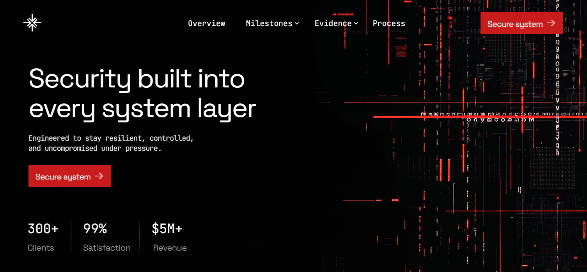
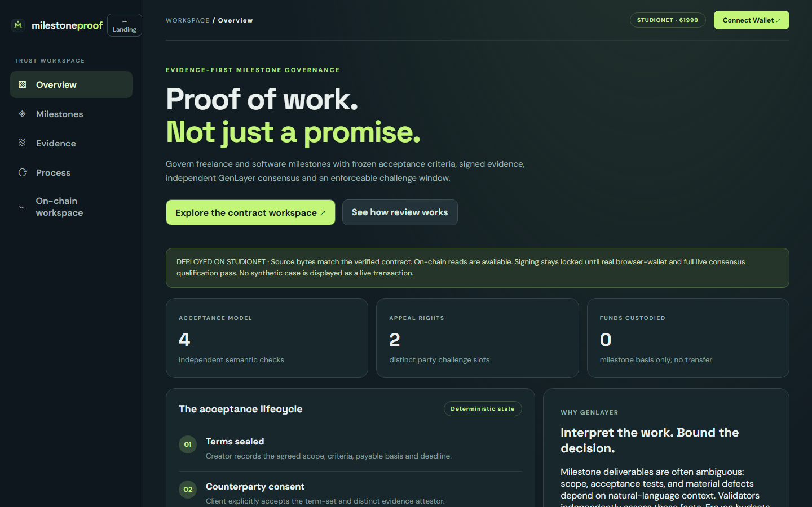
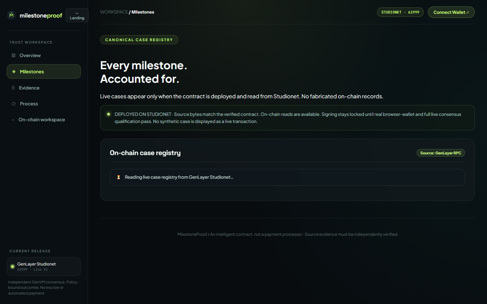
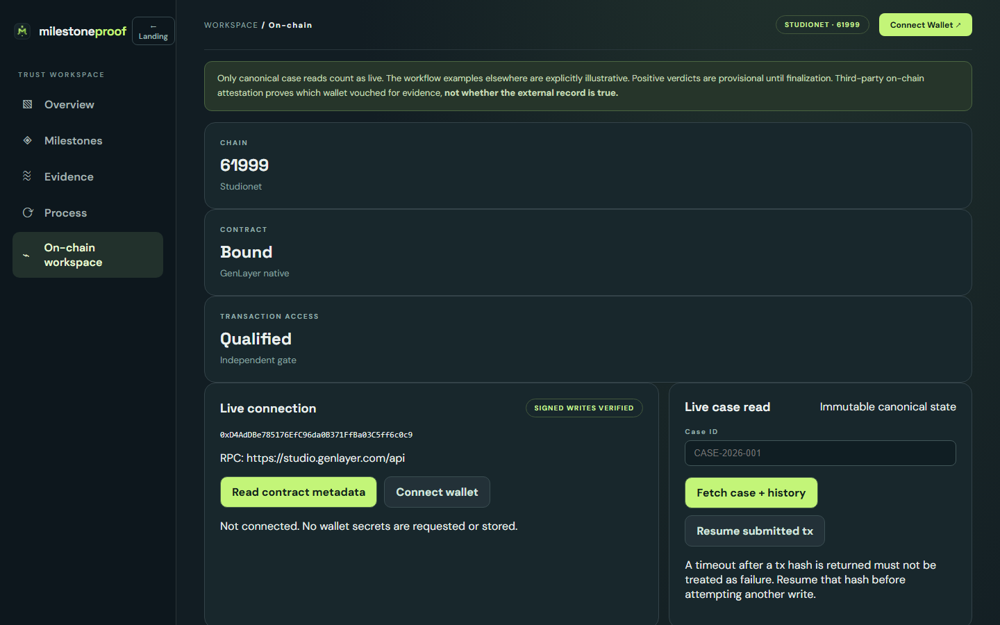

<p align="center">
  
</p>

<h1 align="center">MilestoneProof</h1>

<p align="center"><strong>Govern the handoff. Ship code, not broken trust.</strong></p>

<p align="center">
  Evidence-first freelance and software milestone acceptance governed by GenLayer Intelligent Contracts — frozen acceptance criteria, independent attestor digests, 4-predicate validator consensus, non-custodial milestone calculations, and two-party appeal windows.
</p>

<p align="center">
  <a href="https://milestoneproof-genlayer.vercel.app">Live DApp</a> ·
  <a href="https://milestoneproof-genlayer.vercel.app/app">Operational Workspace</a> ·
  <a href="https://explorer-studio.genlayer.com/address/0xD4AdDBe785176EfC96da0B371FfBa03C5ff6c0c9">Studionet Explorer</a> ·
  <a href="docs/SUBMISSION.md">Portal Submission</a> ·
  <a href="docs/SECURITY.md">Security Boundaries</a>
</p>

<p align="center">
  <a href="https://github.com/GIFTEDLOV/milestoneproof/actions/workflows/ci.yml"></a>
  <a href="https://github.com/GIFTEDLOV/milestoneproof/actions/workflows/release.yml"></a>
</p>

---

## 1. Live Application UI & Visual Walkthrough

### Fixed Fullscreen Atmosphere & Landing Stage (`/`)
*Fixed fullscreen black stage (`#000`) with looping dual-layer atmospheric video plates, exact SVG LUT color-grade filters (`#grade` & `#grade2`), left-locked Space Grotesk headline, subcopy, sharp red action button (`#c81b1c`), client metrics with vertical rule dividers, and one-shot WAAPI entrance choreography.*



---

### Operational Governance Workspace (`/app`)
*Zero-collision contractor and client governance suite featuring left-anchored navigation, real-time Studionet connection telemetry, and deterministic milestone acceptance lifecycle metrics.*



---

### Canonical On-Chain Case Registry (`Milestones` View)
*Dynamic accordion case index querying canonical cases directly from GenLayer Studionet RPC (Chain ID `61999`) with live status badges (`FINALIZED`, `ROUND 2`), frozen agreement quotes, and designated attestation digests.*



---

### Interactive Case Creator & On-Chain Studio (`On-chain` View)
*Full on-chain management workspace: connect MetaMask or any EIP-1193 provider to Studionet, create custom milestone terms, submit evidence digests, broadcast transactions with real-time finality tracking, and inspect verified explorer links.*



---

## 2. On-Chain Deployment & Bytecode Parity

- **Network**: GenLayer Studionet (Chain ID `61999`, RPC `https://studio.genlayer.com/api`)
- **Deployed Address**: [`0xD4AdDBe785176EfC96da0B371FfBa03C5ff6c0c9`](https://explorer-studio.genlayer.com/address/0xD4AdDBe785176EfC96da0B371FfBa03C5ff6c0c9)
- **Deployed Python Source SHA-256**: `1b7a7424b4195ff6df0bd622aa9cdfce79aba2e49a05feb00a9385dafae8610b`
- **Deployment Transaction**: `0x7ab4dad98b090ca61919141fe7968f495239af117e7aed3503cb426c5e82aaab`
- **Canonical Demonstration Case**: `GNEW-milestoneproof-39238668302`
  - Status: `FINALIZED`
  - Rounds: `2`
  - Verdict: `REVIEW_REQUIRED`
  - Challenges: `2` (both creator and client appeal slots exercised)
  - GenVM Consensus: `MAJORITY_AGREE`

---

## 3. Core Architecture & Native GenLayer Justification

Freelance milestones inherently suffer from subjective disputes: scope boundaries, acceptance test passing rates, and alleged defects depend on natural-language context. Traditional smart contracts cannot interpret complex deliverables (such as GitHub source archives or diagnostic logs) without centralizing trust into an admin key.

### 4-Phase Acceptance Lifecycle:
1. **Terms Sealed (`create_case` & `consent`)**: Creator records agreed scope, acceptance criteria, milestone budget basis, and deadline. Counterparty explicitly consents before terms are frozen.
2. **Independent Attestation (`submit_evidence` & `attest_evidence`)**: Delivery records are locked with a cryptographic SHA-256 digest. A designated independent attestor vouches for the record digest.
3. **Validator Consensus (`adjudicate`)**: Leader and validators independently interpret four strict boolean predicates via `gl.vm.run_nondet_unsafe`:
   - `deliverable_in_scope`: Does the work correspond to the agreed specification?
   - `acceptance_criteria_met`: Are all core functional requirements satisfied?
   - `material_defect_supported`: Is there affirmative proof of broken critical flows?
   - `evidence_sufficient`: Is the documentation complete and verifiable?
4. **Challenge & Finality (`challenge` & `finalize_case`)**: Both parties hold distinct challenge slots. If challenged, a second round re-evaluates all evidence before deterministic finalization.

---

## 4. Automated Verification & Testing

### A. Run All Unit & Adversarial Tests
```bash
python -m pytest -v
```
*32/32 tests pass: includes mock GenLayer regression, adversarial red-team prompt injections, budget bounds, attestor spoofing, and repository isolation.*

### B. Live End-to-End On-Chain Audit
```bash
node tests/test_live_e2e.mjs
```
*Directly connects to GenLayer Studionet RPC (61999), verifies exact source byte parity via `gen_getContractCode`, queries case pagination, asserts canonical case state (`GNEW-milestoneproof-39238668302`), validates cryptographic audit history hash links, and asserts HTTP 200 on production Vercel endpoints.*

### C. Build Web Application
```bash
cd web && npm run check && npm run build
```
*Builds the production Vite bundle with 0 errors.*

### D. Secret Leak Audit
```bash
node scripts/secret_scan.mjs
```
*Scans all repository files to guarantee zero leaked private keys, API tokens, or secrets.*

---

## 5. Explicit Trust Boundaries

- **Zero Escrow Custody**: MilestoneProof derives objective milestone acceptance; it never holds client funds or executes automatic payment drains.
- **Attestor Attribution**: An attestor signature confirms wallet attribution, not physical identity or external document veracity.
- **Append-Only State**: All case transitions and historical verdicts are permanently hash-linked on GenLayer Studionet.
